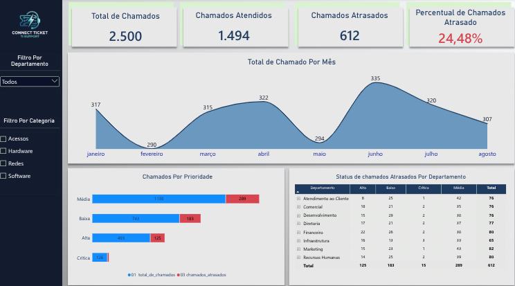

# Imersão Power BI: Central de Suporte de TI (Connect Ticket)
## 🚀 Visão Geral do Dashboard

Abaixo está o resultado visual do painel gerencial de suporte (*Connect Ticket*) construído ao longo das aulas, utilizando um design moderno em Dark Mode e indicadores de SLA em tempo real:

 

## 🛠️ Estrutura do Curso

* **Aula 01:** Introdução ao Power Query, tratamento e limpeza da base de dados de chamados de TI.
* **Aula 02:** Criação de Medidas DAX fundamentais (Total de Chamados, Chamados Atrasados e Taxa de Atraso).
* **Aula 03:** Construção da Página 1 do Dashboard (Visão Geral, Cartões de KPIs, Gráfico de Linhas e Gráficos de Prioridade).
* **Aula 04:** Desafio Prático – Construção autônoma da Página 2 (Painel de Pesquisa Detalhada por ID e Matriz Analítica).
* * 🗂️ [Acesse a Base de Dados Oficial (Google Sheets)](https://docs.google.com/spreadsheets/d/18LFR6ckO6jaq9iw1Kc0tCLN_gsNZgs3B/edit?usp=sharing&ouid=103679383236132218962&rtpof=true&sd=true)
